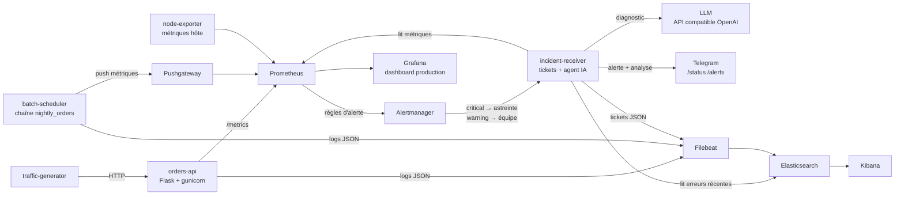

# Production Monitoring Lab

Environnement de production simulé pour pratiquer le **métier d'ingénieur de production / exploitation** : supervision, centralisation des logs, suivi des batchs, alerting, diagnostic et gestion des incidents.

Tout se lance en une commande avec Docker Compose. Des scénarios d'incidents réalistes peuvent être injectés, puis diagnostiqués et résolus avec des runbooks, comme en astreinte.

## Architecture



| Composant | Rôle | URL |
|---|---|---|
| orders-api | Service métier simulé (API de commandes) | http://localhost:18000 |
| batch-scheduler | Ordonnanceur : chaîne de 3 jobs avec dépendances, SLA et relance auto | – |
| Prometheus | Collecte des métriques + règles d'alerte | http://localhost:9090 |
| Alertmanager | Routage des alertes par sévérité, inhibition | http://localhost:9093 |
| Grafana | Dashboard « Production – Vue d'ensemble » (admin / admin) | http://localhost:3000 |
| Kibana | Recherche dans les logs applicatifs, batch et tickets | http://localhost:5601 |

## Démarrage

Prérequis : Docker + Docker Compose, environ 4 Go de RAM libres (Elasticsearch en consomme ~1 Go).

```bash
git clone https://github.com/<ton-user>/prod-monitoring-lab.git
cd prod-monitoring-lab
docker compose up -d --build
./scripts/setup-kibana.sh        # crée la data view "Logs production"
```

Après 1 à 2 minutes : ouvrir Grafana, le dashboard s'affiche par défaut. La chaîne batch tourne toutes les 2 minutes.

> Sous Linux, Elasticsearch peut exiger : `sudo sysctl -w vm.max_map_count=262144`

## Agent de triage IA + alertes Telegram

À chaque alerte déclenchée, `incident-receiver` lance un agent qui :

1. **collecte le contexte** : état des métriques (Prometheus), erreurs des 10 dernières minutes (Elasticsearch), runbook associé à l'alerte ;
2. **produit un diagnostic** via un LLM : résumé d'impact, cause probable, 3 actions issues du runbook, besoin d'escalade ;
3. **envoie le tout sur Telegram**, puis un message ✅ quand l'alerte est résolue.

Le bot répond aussi à `/status` (état de la prod) et `/alerts` (alertes actives), uniquement depuis le chat autorisé.

**Choix de conception**

- **Lecture seule** : l'agent recommande, il n'exécute rien. Une action sur la prod reste validée par un humain.
- **Ancré sur les données** : le prompt interdit d'inventer des informations absentes du contexte, température 0.1.
- **Dégradé maîtrisé** : sans clé LLM ou si l'API tombe, triage par règles (erreur dominante + runbook). L'alerting ne dépend jamais du LLM.
- **Non bloquant** : l'analyse tourne en arrière-plan, Alertmanager reçoit sa réponse immédiatement.
- **Traçable** : chaque triage (moteur utilisé, durée, texte) est journalisé et consultable dans Kibana : `service : "incident-receiver" and triage_engine : *`
- **Agnostique** : toute API compatible OpenAI (Groq, Mistral, OpenAI, Ollama en local).

Configuration :

```bash
cp .env.example .env     # renseigner LLM_* et TELEGRAM_*
docker compose up -d --build incident-receiver
curl localhost:5001/health   # indique si LLM et Telegram sont actifs
```

## Scénarios d'incidents

```bash
./scripts/chaos.sh errors       # 30 % d'erreurs 5xx         → HighErrorRate
./scripts/chaos.sh latency      # latence x3                  → HighLatencyP95
./scripts/chaos.sh memory       # fuite mémoire progressive   → MemoryLeakSuspected
./scripts/chaos.sh down         # arrêt du service            → ServiceDown
./scripts/chaos.sh batch-fail   # job TRANSFORM en échec      → BatchJobFailed + BatchChainBlocked
./scripts/chaos.sh batch-slow   # job EXTRACT hors SLA        → BatchJobFailed (SLA_EXCEEDED)
./scripts/chaos.sh disk         # 1 Go écrit dans le conteneur (exercice de recherche d'espace disque)
./scripts/chaos.sh reset        # retour à la normale
```

Premier réflexe à chaque alerte :

```bash
./scripts/diag.sh               # état hôte, conteneurs, healthcheck, dernières erreurs, alertes actives
```

## Méthode de traitement d'un incident

1. **Détecter** : alerte dans Prometheus / Alertmanager, ticket dans les logs de `incident-receiver`
2. **Qualifier** : impact, périmètre, depuis quand (Grafana)
3. **Diagnostiquer** : logs (Kibana), état système (`diag.sh`), corrélation métriques ↔ logs
4. **Rétablir** : appliquer le runbook correspondant ([runbooks/](runbooks/))
5. **Escalader** si la cause n'est pas connue ou si le délai est dépassé
6. **Documenter** : rapport d'incident ([incidents/TEMPLATE.md](incidents/TEMPLATE.md), [exemple](incidents/INC-EXEMPLE-001-batch-transform.md))

## Recherches Kibana utiles (KQL)

```
service : "orders-api" and level : "ERROR"
service : "orders-api" and duration_ms > 500
service : "batch-scheduler" and run_id : "<id>"        # suivre une exécution de chaîne
service : "batch-scheduler" and error : *
service : "incident-receiver" and severity : "critical" # historique des tickets
```

## Exercices

- [ ] Injecter `errors` et chronométrer : délai entre l'injection, l'alerte et ton diagnostic
- [ ] Combiner `latency` + `errors` : retrouver lequel est apparu en premier avec Grafana et Kibana
- [ ] Lancer `memory` deux fois jusqu'à l'OOM du conteneur ; constater `OOMKilled=true` avec `docker inspect`
- [ ] Rédiger un rapport d'incident pour chaque scénario dans `incidents/`
- [ ] Ajouter une alerte sur le volume de commandes anormalement bas (`orders_created_total`)
- [ ] Remplacer les webhooks factices d'Alertmanager par un vrai canal (Slack, email)
- [ ] Créer un dashboard Kibana : erreurs par type, jobs batch par statut

## Correspondance avec les outils d'entreprise

| Ce lab | En entreprise |
|---|---|
| Prometheus + Grafana | Grafana, Dynatrace, Datadog |
| Elasticsearch + Kibana | Kibana / ELK, Splunk |
| batch-scheduler | Control-M, VTOM, $Universe, Autosys |
| Alertmanager + incident-receiver | ServiceNow, PagerDuty, Opsgenie |
| Agent de triage IA | Dynatrace Davis AI, AIOps |
| healthcheck HTTP | supervision synthétique (EKARA, Dynatrace Synthetic) |

## Structure

```
app/            service orders-api, générateur de trafic, récepteur d'incidents + agent IA
batch/          ordonnanceur de la chaîne nightly_orders
prometheus/     scrape config, règles d'alerte, routage Alertmanager
grafana/        datasource et dashboard provisionnés
filebeat/       collecte des logs vers Elasticsearch
scripts/        chaos.sh, diag.sh, setup-kibana.sh
runbooks/       procédures de traitement par alerte
incidents/      modèle et exemple de rapport d'incident
```

## Arrêt

```bash
docker compose down        # garde les données
docker compose down -v     # supprime aussi les volumes (logs, index Elasticsearch)
```
